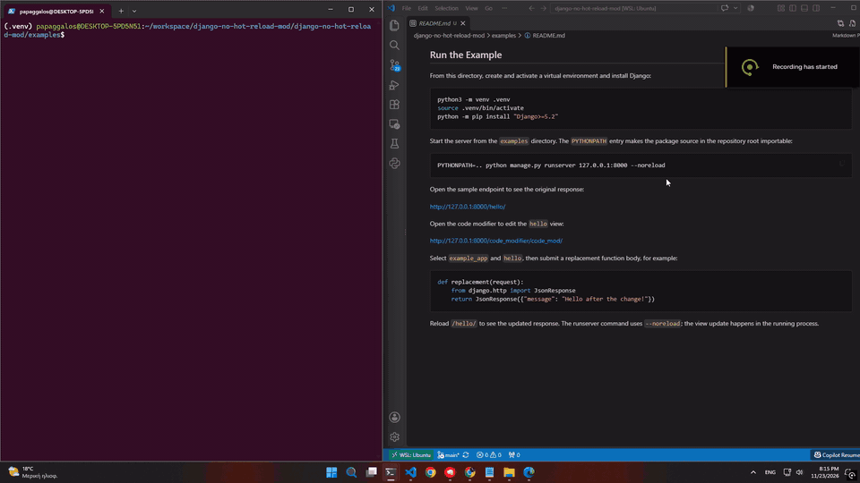

# ✨ django-no-hot-reload-mod ✨

[](https://github.com/AggelosAr/django-no-hot-reload-mod/actions/workflows/tests.yml)

Effortlessly modify Django endpoint functionality without restarting the server.

[django-no-hot-reload-mod on PyPI](https://pypi.org/project/django-no-hot-reload-mod/)

---

## Installation

Run the following command to install the package:

```bash
pip install django-no-hot-reload-mod
```

# Overview
django-no-hot-reload-mod enables real-time modifications to Django endpoints without needing to restart the development server. This is perfect for rapid development and testing, allowing you to make frequent changes on the fly.



---

## Setup Instructions

### 1. Add the app to `INSTALLED_APPS`

In your Django settings, add the code modifier app:

```python
INSTALLED_APPS = [
    # Other apps...
    "django_no_hot_reload_mod.src.code_modifier",
]
```

### 2. Add the URLs

In your URL configuration, include the code modifier URLs:

```python
from django.urls import path, include

urlpatterns = [
    # Other URL patterns...
    path("code_modifier/", include("django_no_hot_reload_mod.src.code_modifier.urls")),
]

```

### 3. Add a view to modify

Add a Django app with a view and URL pattern. Or run the included
[minimal example project](examples/README.md) to try it without modifying your
own project.

### 4. Open the code modifier

Start your Django development server, then visit:

[http://127.0.0.1:8000/code_modifier/code_mod/](http://127.0.0.1:8000/code_modifier/code_mod/)

## Example Project

A minimal Django project is included in [`examples/`](examples/). Follow the
[example instructions](examples/README.md) to start it and try changing the
sample `/hello/` endpoint without restarting the server.


## Running Integration Tests

The integration tests start a sample Django project with tINI-test, exercise the
code modifier endpoints, and verify that a view can be changed without restarting
the server. From the repository root, create and activate a virtual environment,
then install the test dependencies:

```bash
python3 -m venv .venv
source .venv/bin/activate
python -m pip install -r tests/requirements.txt
```

Run tINI-test with the sample Django server command:

```bash
PYTHONPATH=tests/server:. python -m tini_test -d tests \
  -s "python -m django runserver --settings=server_settings 127.0.0.1:8000 --noreload" \
  -u http://127.0.0.1:8000/ -v minimal
```


